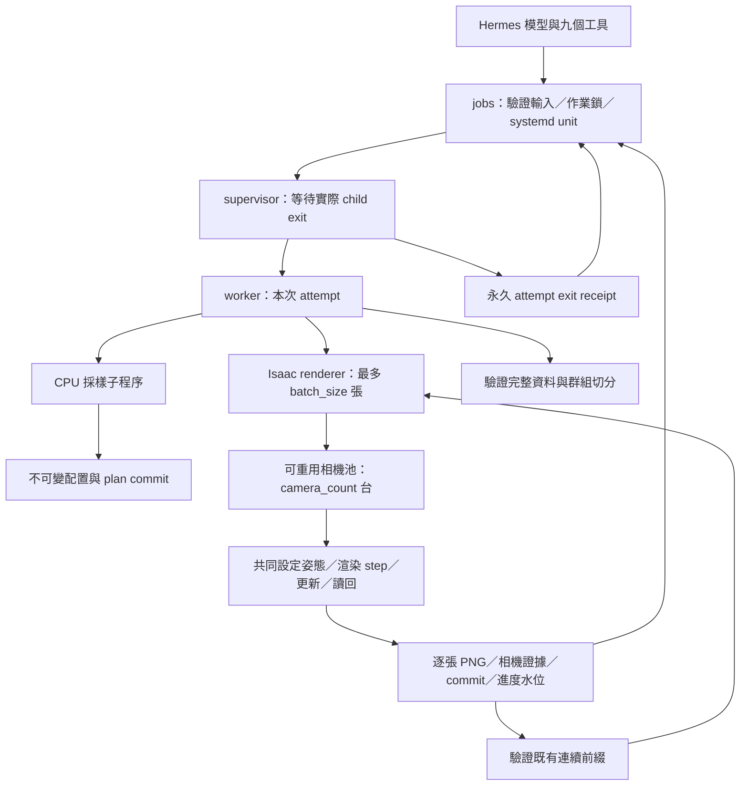

# 架構、恢復與資料格式

本文件對應此獨立 plugin 的執行契約。操作入口與參數範例見 [README](../README.md)。原始場景、語意 overlay 與輸出資料是外部資產；程式不載入其他 plugin 的 Python 模組，不連接其他 Isaac bridge，也不使用其他 plugin 的狀態目錄。

## 程序邊界



[tools.py](../dataset/tools.py) 定義工具 schema、有限數值範圍及 dispatch，不匯入 Isaac／USD。[jobs.py](../dataset/jobs.py) 管理 job identity、狀態、取消與接續；每次 attempt 對應一個專屬 systemd user unit。實際 Python 入口、輸出根目錄、GPU lock、批次大小與時間預算由 [settings.py](../dataset/settings.py) 解析。

[worker.py](../dataset/worker.py) 把 CPU 採樣放在可回收的獨立程序，避免 USD 幾何快取留在後續渲染的父程序。它循序啟動有限大小的 renderer 批次，每批等待程序真正結束並檢查回執，全部完成後才切分。Python 子程序啟動前移除 Hermes 的 `PYTHONPATH`、`PYTHONHOME`、`PYTHONSTARTUP`、`PYTHONUSERBASE` 與 `VIRTUAL_ENV` 污染。

systemd 對整個程序群組施加 10 GiB `MemoryMax`、`MemorySwapMax=0`、有限 `RuntimeMaxSec` 與 `KillMode=control-group`。目前設定僅接受 `memory_max_gb=10`。主機需求為至少 16 GiB RAM，採集前可用 RAM 至少 12 GiB；採集期間可用 RAM 低於 1.5 GiB 時，worker 停止自己的子程序。

GPU lock 是 runtime 設定的共用檔案，取得後仍檢查 `nvidia-smi` 是否已有 compute process。GPU 忙碌時不終止其他工作。作業執行鎖與 GPU lock 的 file descriptor 由自己的子程序繼承，因此父 worker 被殺掉、renderer 尚未結束時，鎖仍阻止重疊執行。

## 有限時間與批次

令 N 為 plan 樣本數、C 為 `config.camera_count`、B 為 runtime 的 `batch_size`、S 為 `startup_timeout_seconds`、P 為 `per_sample_timeout_seconds`、A 為 `sampling_timeout_seconds`。

| 範圍 | 上限 |
| --- | --- |
| CPU 採樣子程序 | A 秒。 |
| 單批 renderer | `ceil(S + min(B, N) × P)` 秒。 |
| renderer 外層程序監督 | 上述單批時間再加 30 秒。 |
| 整個 job | `ceil(600 + A + ceil(N / B) × (S + 60) + N × P)` 秒。 |

預設 A=600、S=600、P=180、B=20。P 是批次預算的每樣本係數，不是每張各自啟停的計時器。N 變大時整批上限同步增加；需要更長的真實 mesh 採樣時間時可提高 A，仍受設定範圍約束。

每一批 renderer 都建立新的 Isaac 程序，重新驗證來源與已提交資料。正常的 60 張／B=20 工作會使用三個批次；若第一批中途只提交三張便中斷，後續 attempt 可按 20、20、17 張接續。批次大小限制的是該次新增提交數，不能把已提交影像重新計入新增數。

C 是每個程序可重用的相機池大小，整數 `1..8`，預設 `1`；它不是 B，也不會把 N 乘上 C。每組分配最多 C 個剩餘姿態，受該程序剩餘張數限制。例如 N=60、B=20、C=4，正常情況使用三個程序，每程序分五組各四個姿態取像。最後一組不足 C 個時不補拍重複樣本。

## 採樣與不可變 plan

[sampling.py](../dataset/sampling.py) 讀取 schema 2 原始面集合，確認 annotation、region Scope、GeomSubset 與 source mesh face indices 相符，並檢查原始 sublayer 及本機依賴的 SHA256。語意 overlay 不得改寫原幾何或 transform。

候選點依合格三角形的 XY 面積加權選面，再以 barycentric 座標取點。接受前檢查原三角面支撐、多層地面歧義、最大坡度、已接受點的最小 XY 間距及相機柱狀區域的 mesh 障礙。這些檢查描述靜態 mesh 的幾何條件，不保證 NuRec 外觀中的所有障礙可見性，也不是完整車體可通行性證明。

採樣最多嘗試 `max_attempts` 次。無法取得 N 點時保存不完整 plan 與拒絕統計，明確失敗；不以重複或無效樣本補足。`seed` 控制整個候選與姿態亂數序列，不是每張影像的獨立 ID。姿態在合法 yaw／pitch／roll 範圍內取樣，地面 Z 加上 `sensor_height_m` 成為相機中心高度。`camera_count` 不參與亂數抽取或群組運算；僅改相機數，其他輸入一致時，採樣姿態、sample ID、位置群組與 N 均保持一致。

`config.json` 是 job 的不可變採樣請求。採樣完成後先原子提交 `plan-commit.json`，內容包含 job ID、配置的 canonical JSON SHA256，以及即將發布的 `plan.json` 精確位元組 SHA256，再原子發布 plan。本次採樣、後續 collect、split 與 resume 都驗證此綁定。

若在 plan commit 發布後、plan 寫入前中斷，可重新執行同一採樣請求，但結果必須與已記錄的 plan SHA 完全相符。已存在卻缺少有效 commit 的 plan 不會被自動採納。替換 plan、修改配置或改變來源後，不可沿用原 job 繼續拍攝。若舊版在commit發布後尚未寫入plan便中斷，新版僅在僅移除原請求未指定、且值為新版預設的camera_count／render_quality欄位組合後能逐位元組重現原commit SHA時採納舊格式；無綁定或其他內容差異仍拒絕。

新計畫在正規化時納入 `camera_count`，省略時明確保存 `1`，因此相機數也受配置／plan hash 綁定。collect 與 resume 不接受相機數覆寫。舊 plan 若原本沒有此欄位，保留原單相機流程；不得直接補入欄位或重寫 plan 進行遷移。

## 影像與同幀相機讀回

[render_worker.py](../dataset/render_worker.py) 支援單一普通 NuRec Volume 與其一個碰撞 Mesh，保留原生 NuRec crop bounds。相機與碰撞 mesh 的顯示調整只寫入匿名 session layer，不儲存來源場景。它先推進 timeline 並驗證時間增加，再暫停於靜態快照。新計畫由 [multicam.py](../dataset/multicam.py) 依 `camera_count` 建立可重用相機池；每台相機各有普通 RenderProduct、RGB annotator 與相機參數 annotator，全部使用同一套要求內參。

每組採集依序執行：

1. 將最多 C 個剩餘姿態分配至相機池，記錄各相機對應的全域 sample ID。
2. 一次設定這一組的相機姿態，統一執行 Replicator step，再依 render_quality 執行0／1／10次額外 Kit 更新（預設normal為1次）。
3. 讀取全部使用中相機的 RGB、相機參數與實際 world transform，逐筆確認相機對應關係。
4. 確認全組所有影像與相機校正通過後，依 sample ID 順序保存、fsync 並發布各筆 checkpoint；該組完成後才移往下一組。

這是同一程序內的多 RenderProduct 渲染，不使用 `TiledCameraSensor`，也沒有背景寫檔佇列與下一組渲染重疊。單次共同 step 不代表 GPU 必然同時完成全部光線計算；吞吐量與顯存成本須由實際硬體量測。程序仍使用單 GPU，原記憶體、GPU 互斥與逾時限制保持有效。

全部樣本已提交但關閉程序前中斷時，恢復仍重驗來源、初始化一個相機並完成正常關閉，不重新產生影像。

相容模式只用於缺少 `camera_count` 的舊 plan，沿用原本逐姿態穩定、捨棄過渡影格及取像流程，保留舊 checkpoint 的繼續採集能力。

相機讀回須符合要求位置、方向、透視內參與已知光線的投影測試。PNG 寫入後重新解碼，確認 RGB、解析度與像素完全一致；相機證據與影像各自保存 SHA256，只有兩者都持久化後才提交樣本。

每筆資料的 `frame_index` 是 plan 內的全域樣本序號；`render_call_index`、`kit_update_number` 與 `capture_batch_id` 記錄實際擷取上下文。同組不同相機可以對應同一次渲染更新；`sample_id` 與全域樣本序號仍各自唯一，不能用 Kit update number 取代資料筆數。Isaac 程序在批次間重啟，因此 Kit update number 不應解讀為跨全部批次連續的影格序列。此資料集是獨立位置的靜態採集，不是行駛車輛影片或連續動態場景。

相機模板只取用受支援的置中、無畸變 perspective Camera 內參。模板 focal length／aperture 優先，顯式 clipping range 可覆蓋模板；模板姿態不沿用。未提供模板時，依指定水平 FOV 建立 configured pinhole。兩種模式都必須由實際讀回證據確認，不能以 prim 名稱推論 ZED、雙目或魚眼感測器身分。

## Checkpoint 與進度水位

[checkpoints.py](../dataset/checkpoints.py) 使用以下提交順序：

1. 寫入暫存 PNG，完成檔案 fsync，再原子替換正式影像並 fsync 目錄。
2. 寫入同 sample ID 的相機 JSON 與驗證證據，完成原子發布及 fsync。
3. 在 `commits/` 發布不可覆寫的樣本記錄，綁定 plan SHA、樣本序號、影像 SHA、相機證據 SHA 與實際 pose。
4. 更新 `capture-watermark.json`，記錄已提交數與最後一筆 commit SHA；再更新可供查詢的 metadata／progress。

`capture-manifest.json` 將輸出目錄綁定到不可變 plan。有效 commits 必須由 `000000.json` 起連續，且每筆都能與該 plan 項目、PNG 解碼與相機證據對應。恢復時逐一重驗，已提交資料損壞會失敗；只有尚未提交、名稱屬於本採集流程的暫存或殘留 payload 可以重新產生。多相機同組仍逐張提交；若在組內中斷，恢復先保留已驗證的連續前綴，再從下一個未提交 sample ID 分配新一組姿態，不把整組視為全部已完成。

水位記錄與已發布的進度／metadata 提供已提交數的持久見證。若 commit 尾端遭刪除，使可見前綴退回已知水位以下，恢復會拒絕，不將它當成「尚未拍攝」。若中斷發生於 commit 已完成但水位尚未更新，可驗證額外的完整 commit 並保留它。

`samples.jsonl` 與 `samples.csv` 是由 commits 產生的索引；中斷後可依已驗證前綴重建。單靠這兩份索引、`progress.json` 或 renderer 的 `ok` 都不能證明背景工作已正常退出。

## 作業狀態與程序退出證據

| 狀態 | 意義 |
| --- | --- |
| `pending` | 已建立 attempt，等待實際執行。 |
| `running` | systemd 或繼承的執行鎖仍顯示工作存活。 |
| `cancelling` | 已要求取消，程序尚未確認結束。 |
| `sampled` | 採樣階段完成並正常退出；可 collect。 |
| `captured` | 所有影像完成並正常退出；可 split。 |
| `completed` | 完整擷取、資料驗證與群組切分成功，且具有正常程序退出證據。 |
| `failed` | 已確認停止，但退出碼或產物契約不符合成功條件。 |
| `cancelled` | 取消已記錄且已確認停止，保留可恢復資料。 |
| `unknown` | 目前無法確認程序狀態；不得視為完成或據此重啟。 |

每批成功需要 `batch_complete=true`、`app_closed=true`、`source_unchanged=true`、正確累計數，以及外層取得的 renderer exit 0。部分批次為 `phase=batch_complete, ok=false`；最後一批才可為 `phase=complete, ok=true`。滿額 commits 若來自未正常退出的 renderer，恢復仍會啟動驗證與關閉流程，不能直接把舊回執提升為成功。

worker 完成後，supervisor 實際等待 child exit，再以 `attempt-N-exit.json` 保存退出碼、worker 狀態快照、request SHA 與 unit identity。成功回執可在 systemd 回收 unit 或主機重啟後繼續證明該 attempt 已完成。沒有退出回執的中斷作業不能因為 `status.json` 曾寫入完成就當作成功。

`status` 的 `capture_progress` 只提供 renderer 回報的逐張數量、階段與 batch；讀取前檢查 job plan／manifest 綁定及檔案路徑。`queried_at` 表示查詢時間。這兩者不取代程序完成證據。

## 取消與接續

取消只能接受本 plugin 的 job ID，解析後僅對記錄中的專屬 unit 發出 stop。子程序清理只終止自己啟動的 process group。外部 Isaac session、Hermes 其他工作與其他 GPU 程序不在控制範圍內。

Resume 先確認前一個 attempt 已確定停止；仍有執行鎖、活躍 unit 或未知 systemd 狀態時拒絕。單純寫下取消請求，不等於 stop 已完成。符合條件時保留原配置、plan、commits 與歷次日誌，建立下一個 attempt；同一 job 不接受修改資料集配置。

原 attempt 若是 pipeline，接續流程依序重用已綁定 plan、驗證提交前綴、補齊剩餘影像，再執行分集。若是 split，保留原 split ratios。成功 job 重送 resume 回傳既有完成狀態，不建立新的拍攝程序。Runtime 的批次與時間預算可於下一個 attempt 重新讀取，原始相機內參、`camera_count` 與採樣 plan 不因此改變。需要不同相機數時應建立新的 job。

## 輸出目錄

```text
RUN_ROOT/JOB_ID/
├── config.json                       不可變採樣請求
├── job.json                          當前 attempt 與 owned unit
├── request-<uuid>.json                各 attempt 的請求與 runtime 快照
├── plan-commit.json                   job／配置／plan SHA 綁定
├── plan.json                         採樣點、要求姿態、來源面與統計
├── status.json                       當前 worker 狀態
├── attempt-N-status.json             舊 attempt 的狀態快照（接續時保存）
├── attempt-N-exit.json               supervisor 的實際 child exit 證據
├── attempt-N-worker.log
├── attempt-N-sampling.log
├── attempt-N-batch-0001.log
├── attempt-N-batch-0001-result.json   該批已驗證回執與程序退出量測
└── dataset/
    ├── capture-manifest.json         輸出目錄／plan 綁定
    ├── capture-watermark.json        已提交數與最後 commit SHA
    ├── commits/000000.json
    ├── images/000000.png
    ├── camera/000000.json            同幀相機讀回與校準證據
    ├── samples.jsonl                 完整樣本記錄索引
    ├── samples.csv                   影像／實際姿態對照表
    ├── metadata.json                 場景、相機 K、座標、模擬與完整性
    ├── progress.json                 最新 renderer 觀測進度
    ├── result.json                   最新 renderer 回執
    ├── split-result.json             已驗證的分集摘要
    └── splits/
        ├── manifest.json
        ├── train.csv
        ├── train.txt
        ├── validation.csv
        ├── validation.txt
        ├── test.csv
        └── test.txt
```

並非每個 attempt 都包含所有檔案，例如只進行採樣時沒有 renderer 日誌。影像與相機證據使用相同 sample ID；CSV／JSONL 保存相對路徑，並連結來源 face、region 與位置 group。中斷時 metadata 或索引可能落後於最新 commits，恢復會由提交記錄重新驗證。

## Pose、K 與分集

世界座標是右手系、Z-up、公尺。`pose_xyzw` 為 `[x,y,z,qx,qy,qz,qw]`，表示 optical camera-to-world；四元數已正規化並使用固定符號慣例。相機 optical 軸為 X 向右、Y 向下、Z 向前。`T_world_camera` 是用於 column-vector 變換的 4×4 矩陣，以 row-major JSON 陣列序列化。

USD Camera 使用 X 向右、Y 向上、−Z 向前。兩者關係為：

```text
T_world_usd = T_world_camera × diag(1, -1, -1, 1)
```

像素座標 u 向右、v 向下，主點為 `(width/2, height/2)`。未使用模板的置中 pinhole，其預期內參為：

```text
f = width / (2 × tan(horizontal_fov / 2))
K = [[f, 0, width/2],
     [0, f, height/2],
     [0, 0, 1]]
```

實際採用值以 metadata 與每張相機讀回證據中的 `intrinsics_K` 為準。模板模式則從 focal length／aperture 計算並驗證 K。requested pose 與 actual pose 都保留，不能只以採樣前的要求姿態代替測量值。

[splitting.py](../dataset/splitting.py) 先重驗每張影像、相機證據、pose、來源 hash 及索引一致性，再分配位置群組。XY 距離在 `group_distance_m` 門檻內的點經傳遞連通形成群組；同群全部進入同一資料集。分配採大群優先、seed 控制同規模群組的順序，再依目標缺額選擇 split。

預設 4:2:2 對應 50%／25%／25%。若群組大小允許，60 張目標為 30／15／15；實際數量以 `split-result.json` 為準。群組不可拆開，因此比例可能有偏差；需要非空 split 的數量若超過群組數會失敗。

Split 檔案先建立於暫存目錄、逐檔同步，再原子發布整個 `splits/`。相同配置的重複 finalize 會逐檔驗證已發布內容並補齊相同回執；不相符的既有內容會失敗。此策略保證位置群組不跨集，並未聲稱各 split 完全地理區塊隔離。

## 渲染品質與持久設定

新plan的 `render_quality` 預設normal；efficiency／normal／quality對應0／1／10次post-step更新。初始化流程不隨選項更動。metadata.render保存實際策略與來源，group timing記錄包含重試的實際額外update次數；每張影像的證據與commit亦保存render_quality及post_step_updates。已有camera_count但沒有品質欄位的舊plan沿用quality／10次；沒有camera_count的舊plan維持legacy後端。恢復只讀舊plan，不補欄位或套用新的normal預設。

`isaac_dataset_configure` 以鎖保護read→merge→atomic replace，保留未指定設定；暫存檔與最終設定權限0600，檔案與目錄完成fsync。設定不在repo內，XDG目錄或ISAAC_DATASET_CONFIG決定位置。新安裝可保留isaac_python=null以便agent稍後配置；未配置時在建立job前拒絕執行，不能退回Hermes的Python。現有job保存的runtime快照與不可變plan不會被設定更新改寫。
